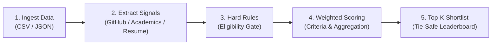
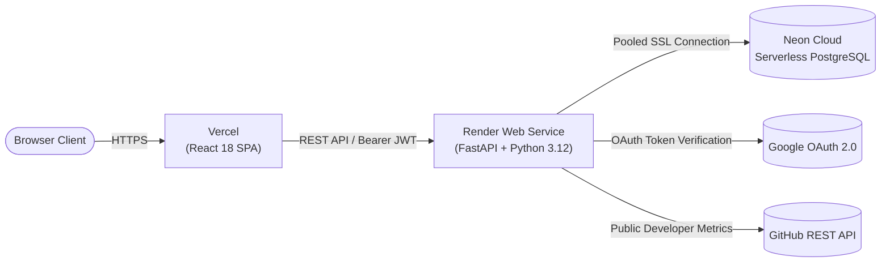

# 🏆 Team Recruitment Automation Tool

[](https://team-recruitment.vercel.app)
[](https://team-recruitment-tool.onrender.com/docs)
[](https://python.org)
[](https://react.dev)
[](https://neon.tech)
[](backend/tests)

> **An explainable, multi-criteria recruitment and shortlisting engine that turns hackathon registrations into deterministic, auditable shortlists with zero black-box scoring.**

---

## 🌐 Live Deployments

* **Web Application (Frontend)**: [https://team-recruitment.vercel.app](https://team-recruitment.vercel.app)
* **Backend API & Swagger Documentation**: [https://team-recruitment-tool.onrender.com/docs](https://team-recruitment-tool.onrender.com/docs)
* **API Health Check**: [https://team-recruitment-tool.onrender.com/api/health](https://team-recruitment-tool.onrender.com/api/health)

---

## 🎯 The Problem & Our Solution

Hackathon organizers receive hundreds or thousands of team registrations and must shortlist the top teams under tight deadlines. Traditional shortlisting processes are:
- **Opaque & Inconsistent**: Reviewers use ad-hoc rubrics with subjective bias.
- **Error-Prone**: Disqualifications (e.g. invalid team sizes, missing links) are easily missed.
- **Unverifiable**: Teams ask why they weren't shortlisted, but organizers have no audit trail to defend their decisions.

**The Team Recruitment Automation Tool** solves this by establishing a **deterministic 5-stage evaluation pipeline** where every candidate score is mathematically reconcilable, all eligibility determinations include plain-language rationales, and cutoff ties are safely flagged for human review.

---

## ⚡ The 5-Stage Evaluation Pipeline



### 1. Ingestion & Dynamic Discovery
* Ingests CSV or structured JSON registration datasets.
* **Smart Schema Mapping**: Auto-detects columns using confidence-ranked candidate discovery (e.g. exact URLs vs. usernames, aliases like `github_link`).
* **Custom Signals Engine**: Unrecognized columns (e.g. `track`, `certifications`, `hackathons_won`) are dynamically lifted into first-class signals without code changes.
* **Data Resiliency**: Preserves duplicate team names with isolated temporary IDs, autogenerates missing member IDs, and suppresses phantom missing-data warnings.

### 2. Pluggable Signal Extraction
* **GitHub Analyzer**: Verifies live developer profiles via GitHub REST API, extracting public repository counts, star/fork counts, and 90-day activity timestamps.
* **Academic Analyzer**: Normalizes CGPA/GPA across diverse grading scales (10-point, 4-point, percentage) and parses academic year/batch standing.
* **Resume Document Parser**: Secure SSRF-protected extraction from PDF and DOCX files without OCR, isolating technical skills, frameworks, databases, work experience duration, and verified links.

### 3. Deterministic Eligibility & Hard Rules
* Evaluates candidate teams against configurable hard requirements before scoring.
* **3-State Classification**: Assigns `ELIGIBLE`, `INELIGIBLE` (disqualified), or `NEEDS_REVIEW`.
* **10 Spec-Compliant Rule Evaluators**: Team size limits, mandatory profile links, required skill containment, numeric signal thresholds, cross-team email duplicate detection, and category-level distribution caps.
* **Plain-Language Explanations**: Every team receives explicit, human-readable pass/fail bullet points for complete transparency.

### 4. Transparent Weighted Scoring
* Computes normalized multi-criteria scores using organizer-defined weights.
* **Dynamic Share Normalization**: Organizers configure relative weights (e.g. GitHub: 40%, Academics: 30%, Resume: 30%) with automatic real-time percentage reconciliation.
* **Member Aggregation Strategies**: Aggregate individual member signals to team-level scores using `mean`, `max`, `min`, `clamped_sum`, `lead_only`, or `top_k`.
* **Missing-Data Integrity**: Missing values never silently convert to zero; they follow explicit organizer-configured fallback policies.

### 5. Boundary-Aware Top-K Ranking
* Ranks eligible teams deterministically with multi-level tie-breaking.
* **Cutoff Tie Protection**: When teams at the boundary score identically (e.g., a tie for the 5th spot in a Top-5 shortlist), the engine safely flags the cutoff conflict rather than making an arbitrary choice.
* **Reviewer Overrides & Audit Trail**: Organizers can execute reason-backed eligibility overrides that are permanently logged to the immutable configuration run history.
* **One-Click CSV Export**: Download the complete leaderboard and scoring breakdown with UTF-8 BOM encoding for Excel compatibility.

---

## 🛠️ Technology Stack

| Layer | Technologies |
| :--- | :--- |
| **Frontend** | React 18 · TypeScript · Vite · Tailwind CSS · TanStack Query v5 · Lucide React · React Router v6 |
| **Backend** | Python 3.12 · FastAPI · Pydantic v2 · SQLAlchemy 2.0 · Alembic · Uvicorn · HTTPX |
| **Document Processing** | PyPDF (`pypdf`) · Python-Docx (`python-docx`) |
| **Database** | PostgreSQL on Neon Serverless Cloud · Psycopg 3 with SSL connection pooling |
| **Authentication** | Google Identity Services OAuth 2.0 · PyJWT (HMAC-SHA256) |
| **Hosting & CI/CD** | Vercel (Frontend SPA) · Render (FastAPI Web Service) · Docker |
| **Quality & Tests** | Pytest (459 automated unit & integration tests, 100% pass rate) |

---

## 💻 Local Development Setup

### Prerequisites
* **Python 3.12+**
* **Node.js 18+** & `npm`
* **PostgreSQL** (optional; defaults to in-memory storage for rapid local development)

### 1. Clone the Repository
```bash
git clone https://github.com/mehul-khandelwal26/Team_Recruitment.git
cd Team_Recruitment
```

### 2. Backend Setup
```bash
cd backend

# Create and activate virtual environment
python -m venv venv
# On Windows:
.\venv\Scripts\activate
# On macOS/Linux:
source venv/bin/activate

# Install dependencies
pip install -r requirements.txt

# Configure environment variables
cp .env.example .env

# Run FastAPI development server
uvicorn app.main:app --reload --host 127.0.0.1 --port 8000
```
* Backend API will be available at: [http://localhost:8000](http://localhost:8000)
* Interactive Swagger Docs: [http://localhost:8000/docs](http://localhost:8000/docs)

### 3. Frontend Setup
In a new terminal:
```bash
cd frontend

# Install dependencies
npm install

# Start Vite development server
npm run dev
```
* Frontend application will be available at: [http://localhost:5173](http://localhost:5173)

---

## ☁️ Deployment Architecture

The application is architected for zero-maintenance serverless cloud deployment:



* **Frontend (Vercel)**: Configured with `vercel.json` SPA rewrite rules to ensure seamless client-side routing on hard refreshes.
* **Backend (Render)**: Automatically runs with Python 3.12.8, executes database migrations, and exposes the REST API with configurable CORS headers.
* **Database (Neon)**: Persistent relational storage using Alembic migrations with connection pooling and SSL encryption.

---

## 🔑 Environment Variables Reference

### Backend (`backend/.env`)

| Variable | Default / Example | Purpose |
| :--- | :--- | :--- |
| `APP_ENV` | `development` / `production` | Application runtime environment |
| `STORAGE_BACKEND` | `postgres` (or `memory`) | Storage engine (`postgres` for cloud, `memory` for test) |
| `DATABASE_URL` | `postgresql+psycopg://...` | PostgreSQL connection string with SSL |
| `DATABASE_URL_POOLED` | `postgresql+psycopg://...` | Transaction-pooled PostgreSQL connection (Neon) |
| `CORS_ORIGINS` | `https://team-recruitment.vercel.app` | Comma-separated allowed frontend origins (or `*`) |
| `JWT_SECRET_KEY` | `<secure-random-64-char-string>` | Secret key used to sign and verify JWT session tokens |
| `AUTH_ENABLED` | `true` | Enables authentication gateway |
| `GOOGLE_CLIENT_ID` | `<client-id>.apps.googleusercontent.com` | Google Cloud OAuth 2.0 Web Client ID |
| `GITHUB_TOKEN` | `ghp_...` (optional) | Increases GitHub API rate limits from 60 to 5,000 req/hr |

### Frontend (`frontend/.env.local` / Vercel)

| Variable | Example | Purpose |
| :--- | :--- | :--- |
| `VITE_API_BASE_URL` | `https://team-recruitment-tool.onrender.com` | FastAPI backend URL (no trailing slash) |

---

## 🧪 Testing & Verification

The backend codebase maintains strict reliability with **459 automated tests**:

```bash
cd backend
pytest tests/ -v
```

```text
============================== 459 passed in 14.82s ==============================
```

Frontend production build verification:
```bash
cd frontend
npm run build
```

---

## 📜 License

Distributed under the **MIT License**. See `LICENSE` for more information.
